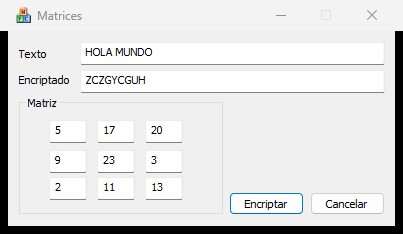
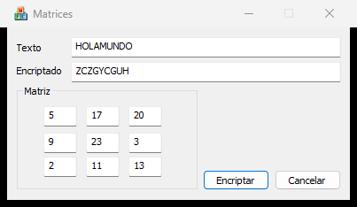
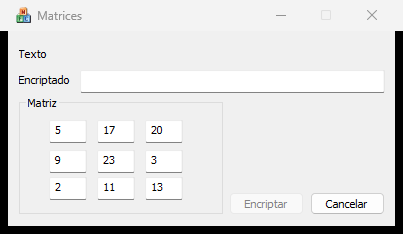

# Linear algebra with a Hill cipher · Álgebra lineal con un cifrado de Hill
[English](#english) · [Español](#español)

## English


Legacy Windows exercise for transforming short messages with a 3 × 3 Hill cipher matrix

> [!WARNING]
> **Status: Legacy.** The Hill cipher is a classroom example. Use it only with invented messages.

### Overview

The Windows dialog turns letters into numbers, multiplies groups of three by a matrix and converts the result back into letters. It demonstrates how the same key can transform a message and help recover it.

### Features

- Change the nine entries of the 3 × 3 key.
- Use **Encriptar** to transform a message into groups of letters.
- Clear **Texto** and use **Desencriptar** to recover a message from the encoded field.

### Requirements

Windows 11. Visual Studio Community 2026 18.11.4 with Desktop development with C++, MSVC v145 14.51.36263 for Win32, MFC and Windows SDK 10.0.26100.0.

### Getting started

Run from the repository root in Developer PowerShell for Visual Studio.

```powershell
MSBuild Matrices.sln /m:1 /t:Rebuild /p:Configuration=Release /p:Platform=Win32 /p:PreferredToolArchitecture=x64
.\Release\Matrices.exe
```

### Usage

Leave the key at its defaults. Enter `HOLA MUNDO` in **Texto** and choose **Encriptar**. The result is `ZCZGYCGUH`. Clear **Texto**, leave the result in place and choose **Desencriptar** to recover `HOLAMUNDO`.

For a custom key, its determinant must be coprime to 26. The legacy dialog rejects a zero determinant but lets other invalid keys through. With the diagonal key `(2, 1, 1)`, for example, `BCD` becomes `CCD` and decodes to `CEG`.

### Project structure

`Matrices/MatricesDlg.cpp` handles the dialog and transformations. `Matrices.sln` and `Matrices/Matrices.vcxproj` build the Win32 application. `Matrices.legacy.sln` and `Matrices/Matrices.vcproj` preserve the older Visual Studio project.

### Contributing

This exercise is kept for reference. Include the key and input when reporting a calculation issue.

### Support

Use the repository’s Issues to report a reproducible build or example issue.

### History

The 2008 snapshot recovers the original Windows exercise. The 2026 reconstruction adds the converted solution and bilingual instructions.

### Verification

On November 19, 2026, both commits built on Windows 11 Pro build 26300 with Visual Studio 18.11.4, MSBuild 18.11.1.51303, MSVC 14.51.36263 (v145) and Windows SDK 10.0.26100.0. For each snapshot, `MSBuild Matrices.sln /m:1 /t:Rebuild /p:Configuration=Release /p:Platform=Win32 /p:PreferredToolArchitecture=x64` and `Release\Matrices.exe` exited with code 0. The dialog encoded and recovered the example with the default key.



The encoded result occupies the second field.



The decoded result appears in the first field.



The dialog switches from encoding to decoding when the original text is cleared.

### License

The [MIT notice](LICENSE) covers the project’s own contributions. See [Third-party notices](THIRD-PARTY-NOTICES.md) for the original attribution of the two routines from Matrices.rar.

---

## Español


Ejercicio legado para Windows que transforma mensajes cortos con una matriz 3 × 3 del cifrado de Hill

> [!WARNING]
> **Estado: legado.** El cifrado de Hill es un ejemplo de clase. Úsalo con mensajes inventados.

### Descripción general

La ventana de Windows convierte letras en números, multiplica grupos de tres por una matriz y vuelve a convertir el resultado en letras. Sirve para ver cómo la misma clave puede transformar un mensaje y ayudar a recuperarlo.

### Funciones

- Cambia los nueve valores de la clave 3 × 3.
- Usa **Encriptar** para transformar un mensaje en grupos de letras.
- Borra **Texto** y usa **Desencriptar** para recuperar el mensaje del campo codificado.

### Requisitos

Windows 11. Visual Studio Community 2026 18.11.4 con Desarrollo para el escritorio con C++, MSVC v145 14.51.36263 para Win32, MFC y SDK de Windows 10.0.26100.0.

### Cómo empezar

Ejecuta desde la raíz en Developer PowerShell para Visual Studio.

```powershell
MSBuild Matrices.sln /m:1 /t:Rebuild /p:Configuration=Release /p:Platform=Win32 /p:PreferredToolArchitecture=x64
.\Release\Matrices.exe
```

### Uso

Deja la clave predeterminada. Escribe `HOLA MUNDO` en **Texto** y elige **Encriptar**. El resultado es `ZCZGYCGUH`. Borra **Texto**, conserva el resultado y elige **Desencriptar** para recuperar `HOLAMUNDO`.

Para una clave personalizada, el determinante debe ser coprimo con 26. La ventana histórica rechaza un determinante cero, pero admite otras claves inválidas. Con la clave diagonal `(2, 1, 1)`, por ejemplo, `BCD` pasa a `CCD` y se recupera como `CEG`.

### Estructura del proyecto

`Matrices/MatricesDlg.cpp` gestiona la ventana y las transformaciones. `Matrices.sln` y `Matrices/Matrices.vcxproj` compilan la aplicación Win32. `Matrices.legacy.sln` y `Matrices/Matrices.vcproj` conservan el proyecto de Visual Studio original.

### Contribuir

Este ejercicio se conserva como referencia. Incluye la clave y la entrada si reportas un problema con un cálculo.

### Soporte

Usa la sección Issues para reportar un problema reproducible de compilación o del ejemplo.

### Historia

La versión de 2008 recupera el ejercicio original para Windows. La reconstrucción de 2026 agrega la solución convertida y las instrucciones bilingües.

### Verificación

El 19 de noviembre de 2026, ambos commits compilaron en Windows 11 Pro compilación 26300 con Visual Studio 18.11.4, MSBuild 18.11.1.51303, MSVC 14.51.36263 (v145) y SDK de Windows 10.0.26100.0. Para cada versión, `MSBuild Matrices.sln /m:1 /t:Rebuild /p:Configuration=Release /p:Platform=Win32 /p:PreferredToolArchitecture=x64` y `Release\Matrices.exe` terminaron con código 0. El diálogo codificó y recuperó el ejemplo con la clave predeterminada.


El resultado codificado ocupa el segundo campo.


El resultado recuperado aparece en el primer campo.


El cuadro pasa de codificar a recuperar el texto al borrar el mensaje original.

### Licencia

El [aviso MIT](LICENSE) cubre los aportes propios del proyecto. Consulta los [avisos de terceros](THIRD-PARTY-NOTICES.md) para consultar la atribución de las dos rutinas de Matrices.rar.
